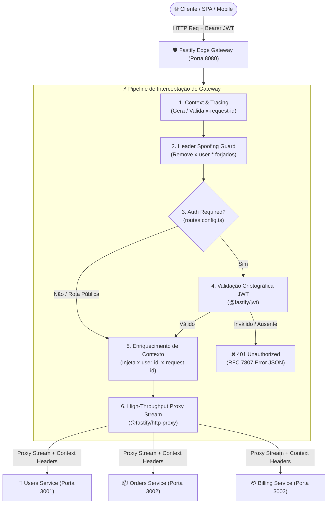

# 🚀 Fastify Edge API Gateway

[](https://github.com/ViktorGabriel/fastify-edge-api-gateway/actions)
[](https://nodejs.org/)
[](https://fastify.dev/)
[](https://www.typescriptlang.org/)
[](LICENSE)

API Gateway de borda, ultraleve e de altíssima vazão projetado sob padrões de **Engenharia de Infraestrutura e Plataforma**. Desenvolvido com **Fastify 5** e **@fastify/http-proxy**, ele centraliza o roteamento declarativo, interceptação e validação criptográfica de tokens **JWT**, enriquecimento de contexto distribuído (**`x-user-id`**, **`x-request-id`**) e proteção ativa contra *Header Spoofing*.

---

## 🏛️ Arquitetura de Plataforma

O Gateway opera na camada de borda (L7 / Reverse Proxy) com streaming nativo via Node.js streams, evitando carregar payloads pesados inteiramente na memória RAM e garantindo latências sub-milissegundo em operações de proxy reverso.



---

## 💎 Diferenciais de Engenharia de Plataforma

1. **Zero-Overhead Streaming:** Utiliza `@fastify/http-proxy` que repassa chunks de streaming HTTP diretamente ao upstream sem deserializar o body caso desnecessário, mitigando pressão no Garbage Collector.
2. **Roteamento Declarativo Centralizado:** Mapeamento em `src/config/routes.config.ts`, permitindo que novas rotas, upstreams, métodos autorizados e políticas de autenticação sejam adicionadas sem tocar no core do servidor.
3. **Prevenção Ativa de Header Spoofing:** Clientes maliciosos não conseguem forjar cabeçalhos internos como `x-user-id`. O Gateway expurga qualquer cabeçalho de identidade recebido externamente e injeta estritamente o `sub` validado criptograficamente no token JWT.
4. **Rastreabilidade Distribuída (Tracing):** Injeta ou reutiliza `x-request-id` (UUID v4) de ponta a ponta, propagando o cabeçalho tanto para os microsserviços upstream quanto no response header ao cliente.
5. **Observabilidade & Kubernetes Probes:** Endpoints nativos `/health/live` (Liveness), `/health/ready` (Readiness) e `/gateway/routes` (catálogo dinâmico das rotas de proxy ativas).
6. **Graceful Shutdown:** Drenagem de conexões HTTP ativas mediante interceptação de sinais POSIX `SIGINT` e `SIGTERM`.

---

## 📋 Catálogo Declarativo de Rotas (`routes.config.ts`)

As rotas são orquestradas pelo arquivo central [src/config/routes.config.ts](file:///d:/mais%20projetos/API-Gateway/src/config/routes.config.ts):

| Rota no Gateway | Upstream de Destino | Path Upstream | Autenticação | Métodos Aceitos | Descrição |
| :--- | :--- | :--- | :---: | :---: | :--- |
| `/api/v1/auth/*` | `USERS_SERVICE_URL` | `/auth/*` | ❌ Não | `POST`, `GET` | Autenticação pública e emissão de tokens |
| `/api/v1/users/*` | `USERS_SERVICE_URL` | `/users/*` | ✅ **Sim** | `GET`, `POST`, `PUT`, `PATCH`, `DELETE` | Gestão de perfis e contas (enriquece `x-user-id`) |
| `/api/v1/catalog/*` | `ORDERS_SERVICE_URL` | `/catalog/*` | ❌ Não | `GET` | Catálogo de produtos aberto ao público |
| `/api/v1/orders/*` | `ORDERS_SERVICE_URL` | `/orders/*` | ✅ **Sim** | `GET`, `POST`, `PUT`, `DELETE` | Criação e histórico de pedidos |
| `/api/v1/billing/*` | `BILLING_SERVICE_URL` | `/billing/*` | ✅ **Sim** | `GET`, `POST` | Processamento financeiro e faturas |

---

## 🛠️ Tecnologias Utilizadas

- **Runtime:** [Node.js 22 LTS](https://nodejs.org/)
- **Core Framework:** [Fastify 5](https://fastify.dev/)
- **Proxy Engine:** [@fastify/http-proxy](https://github.com/fastify/fastify-http-proxy)
- **Segurança de Borda:** [@fastify/jwt](https://github.com/fastify/fastify-jwt), [@fastify/helmet](https://github.com/fastify/fastify-helmet), [@fastify/cors](https://github.com/fastify/fastify-cors)
- **Validação de Schema:** [Zod 3](https://zod.dev/)
- **Linguagem & Tipagem:** [TypeScript 5](https://www.typescriptlang.org/)
- **Testes Automatizados:** [Vitest 3](https://vitest.dev/)
- **Bundler:** [tsup](https://tsup.egoist.dev/) (ESM)
- **Containerização:** [Docker](https://www.docker.com/) (Multi-stage) & [Docker Compose](https://docs.docker.com/compose/)

---

## 🚀 Como Executar

### Pré-requisitos
- Node.js 20+ ou 22+
- Pnpm (ou Npm / Corepack)
- Docker & Docker Compose (opcional para execução em containers)

### 1. Clonar e Instalar Dependências

```bash
git clone https://github.com/ViktorGabriel/fastify-edge-api-gateway.git
cd fastify-edge-api-gateway
pnpm install
```

### 2. Configurar Variáveis de Ambiente

```bash
cp .env.example .env
```

### 3. Execução em Desenvolvimento (com Mocks Upstream)

Em um terminal, inicie os microsserviços simulados (Users na porta 3001 e Orders na 3002):
```bash
pnpm run dev:mock
```

No outro terminal, inicie o Gateway (porta 8080):
```bash
pnpm run dev
```

### 4. Execução Completa via Docker Compose

```bash
docker compose up --build
```

O Gateway estará pronto e exposto em `http://localhost:8080`.

---

## 🧪 Demonstração Prática com cURL

### 1. Verificação de Saúde (Liveness Probe)
```bash
curl -i http://localhost:8080/health/live
```
**Resposta:**
```json
HTTP/1.1 200 OK
x-request-id: 28bb98b8-fa24-44a5-9be9-a1b66f2fb7c2

{
  "status": "UP",
  "timestamp": "2026-11-07T22:30:00.000Z",
  "uptimeSeconds": 42
}
```

---

### 2. Acesso à Rota Pública (Sem Token)
```bash
curl -i http://localhost:8080/api/v1/catalog/items
```
*O Gateway intercepta a rota, injeta o `x-request-id` e faz o proxy para o serviço de pedidos.*

---

### 3. Tentativa de Acesso à Rota Protegida Sem Token (Bloqueio 401)
```bash
curl -i http://localhost:8080/api/v1/users/profile
```
**Resposta do Gateway (Tráfego bloqueado na borda antes de atingir o upstream):**
```json
HTTP/1.1 401 Unauthorized
x-request-id: bcb47631-fca5-48b2-b430-8ca964c05e19

{
  "statusCode": 401,
  "error": "Unauthorized",
  "message": "Cabeçalho 'Authorization' ausente. Forneça um token no formato 'Bearer <token>'",
  "requestId": "bcb47631-fca5-48b2-b430-8ca964c05e19",
  "timestamp": "2026-11-07T22:31:00.000Z"
}
```

---

### 4. Obtenção de Token JWT Válido via Rota Pública
```bash
curl -i -X POST http://localhost:8080/api/v1/auth/login \
  -H "Content-Type: application/json" \
  -d '{"userId": "usr_viktor_dev", "role": "platform_lead"}'
```
*Copie o campo `token` retornado no JSON.*

---

### 5. Acesso à Rota Protegida com Enriquecimento de Contexto
```bash
curl -i http://localhost:8080/api/v1/users/profile \
  -H "Authorization: Bearer <SEU_TOKEN_AQUI>"
```
**Resposta do Upstream confirmando que recebeu `x-user-id` e `x-request-id`:**
```json
HTTP/1.1 200 OK
x-request-id: 9a2df718-2c2e-4b6e-b7d6-7cbb1fa02187

{
  "message": "Perfil do usuário recuperado com sucesso",
  "service": "users-service",
  "contextReceived": {
    "userId": "usr_viktor_dev",
    "userRole": "platform_lead",
    "requestId": "9a2df718-2c2e-4b6e-b7d6-7cbb1fa02187",
    "forwardedBy": "fastify-api-gateway",
    "gatewayTimestamp": "2026-11-07T22:32:00.000Z"
  }
}
```

---

## 🚦 Executando Testes Automatizados

A suíte de testes com **Vitest** valida:
- Verificação dos probes `/health/live`, `/health/ready` e `/gateway/routes`.
- Proxying transparente em rotas públicas com injeção de correlation ID.
- Rejeição de requisições desprovidas de credenciais (401 Unauthorized).
- Rejeição de tokens expirados ou com assinatura HMAC corrompida.
- Validação criptográfica de tokens e propagação de `x-user-id` ao upstream.
- Imunidade a Header Spoofing (sobrescrita forçada de cabeçalhos de identidade enviados pelo cliente).
- Validação de verbos HTTP permitidos na configuração declarativa (405 Method Not Allowed).

```bash
# Executar todos os testes
pnpm test

# Executar testes com relatório de cobertura
pnpm run test:coverage

# Verificação estática de tipos
pnpm run typecheck
```

---

## 🔒 Auditoria de Segurança & Padrão de Engenharia

Este repositório segue a política de segurança e engenharia estabelecida pelo **GitHub Portfolio Guardian**:
- **Zero-Leak Policy:** Regras estritas no `.gitignore` impedindo versionamento acidental de arquivos `.env`, chaves privadas e artefatos de IA (`.agents/`, `CLAUDE.md`, etc.).
- **Container Seguro:** Execução em imagem Alpine sob usuário sem privilégios de root (`USER node`).
- **Resiliência:** Timeout declarativo por rota e barreira de contenção contra falhas de conexão (`502 Bad Gateway` tratado).

---

## 📄 Licença

Distribuído sob a licença [MIT](LICENSE). Desenvolvido por [Viktor Gabriel](https://github.com/ViktorGabriel).
