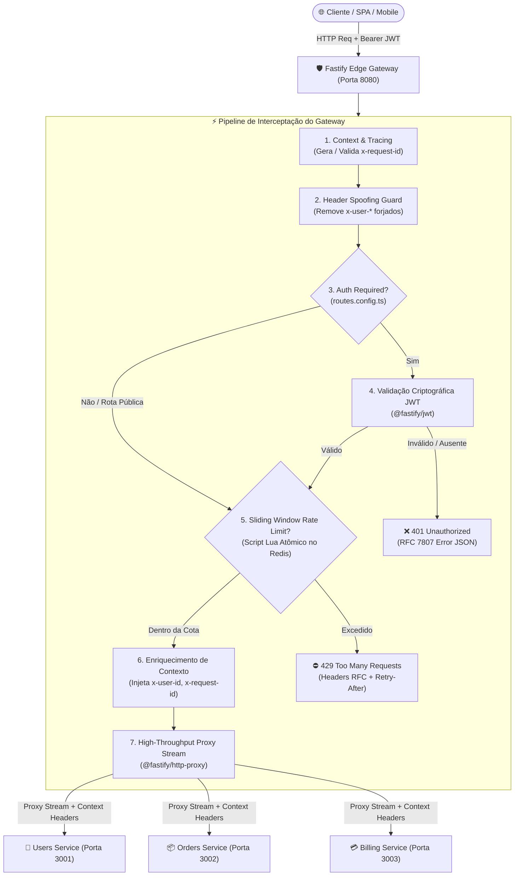

# 🚀 Fastify Edge API Gateway

[](https://github.com/ViktorGabriel/fastify-edge-api-gateway/actions)
[](https://nodejs.org/)
[](https://fastify.dev/)
[](https://redis.io/)
[](https://www.typescriptlang.org/)
[](LICENSE)

API Gateway de borda, ultraleve e de altíssima vazão projetado sob padrões de **Engenharia de Infraestrutura e Plataforma**. Desenvolvido com **Fastify 5** e **@fastify/http-proxy**, ele centraliza:
- Roteamento declarativo mapeado no arquivo central `routes.config.ts`.
- Middleware customizado de **Rate Limiting** com **Sliding Window Counter** atômico executado em scripts **Lua no Redis**.
- Interceptação e validação criptográfica de tokens **JWT** na borda.
- Enriquecimento de contexto distribuído (**`x-user-id`**, **`x-request-id`**).
- Proteção ativa contra *Header Spoofing* e injeção de cabeçalhos internos.

---

## 🏛️ Arquitetura de Plataforma

O Gateway opera na camada de borda (L7 / Reverse Proxy) com streaming nativo via Node.js streams, evitando carregar payloads pesados inteiramente na memória RAM e garantindo latências sub-milissegundo em operações de proxy reverso.



---

## ⏱️ Algoritmo de Sliding Window Counter via Redis e Lua

Diferente de contadores simples de janela fixa (*Fixed Window*) que sofrem de rajadas de tráfego na virada de minuto (duplicando a capacidade real), o **Sliding Window Counter** calcula uma média contínua e precisa no tempo.

### Atomicidade Garantida com Script Lua
A avaliação e o registro das requisições ocorrem em uma **única transação atômica** no Redis via script Lua:
1. `ZREMRANGEBYSCORE key 0 (now - windowMs)`: purga atopicamente eventos fora da janela deslizante móvel.
2. `ZCARD key`: conta o número exato de requisições na janela ativa.
3. Se `count < limit`:
   - Executa `ZADD key now requestId` e `PEXPIRE key windowMs`.
   - Retorna permitido (`allowed=1`) e o saldo restante (`remaining = limit - count - 1`).
4. Se `count >= limit`:
   - Executa `ZRANGE key 0 0 WITHSCORES` para obter a requisição mais antiga e calcular o tempo exato de espera (`retryAfter = oldestTime + windowMs - now`).
   - Retorna bloqueado (`allowed=0`) e o valor de `retryAfter` em segundos.

### Headers RFC Retornados
Em todas as requisições, o Gateway injeta os cabeçalhos padrão da indústria:
- `X-RateLimit-Limit`: Limite máximo de requisições permitido na janela.
- `X-RateLimit-Remaining`: Quantidade restante de chamadas disponíveis.
- `X-RateLimit-Reset`: Segundos até o reset da janela móvel.
- `Retry-After`: Segundos inteiros para aguardar antes de tentar novamente (injetado no **HTTP 429** conforme RFC 6585 e RFC 7231).

---

## 📋 Catálogo Declarativo de Rotas (`routes.config.ts`)

As rotas são orquestradas pelo arquivo central [src/config/routes.config.ts](file:///d:/mais%20projetos/API-Gateway/src/config/routes.config.ts):

| Rota no Gateway | Upstream | Autenticação | Rate Limit | Estratégia de Chave | Propósito |
| :--- | :--- | :---: | :---: | :---: | :--- |
| `/api/v1/auth/*` | Users Service | ❌ Não | **5 req / 60s** | `ip` | Defesa contra ataques de Brute-Force e Credential Stuffing |
| `/api/v1/users/*` | Users Service | ✅ **Sim** | **100 req / 60s** | `user-or-ip` | Perfil e dados de conta por usuário autenticado |
| `/api/v1/catalog/*` | Orders Service | ❌ Não | **200 req / 60s** | `ip` | Catálogo aberto com alta vazão por endereço IP |
| `/api/v1/orders/*` | Orders Service | ✅ **Sim** | **20 req / 60s** | `user` | Checkout e transações protegidas por User ID |
| `/api/v1/billing/*` | Billing Service | ✅ **Sim** | **10 req / 60s** | `user` | Faturamento com controle estrito de concorrência |

---

## 🛠️ Tecnologias Utilizadas

- **Runtime:** [Node.js 22 LTS](https://nodejs.org/)
- **Core Framework:** [Fastify 5](https://fastify.dev/)
- **In-Memory Store:** [Redis 7](https://redis.io/) via [ioredis](https://github.com/redis/ioredis)
- **Proxy Engine:** [@fastify/http-proxy](https://github.com/fastify/fastify-http-proxy)
- **Segurança & Tokens:** [@fastify/jwt](https://github.com/fastify/fastify-jwt), [@fastify/helmet](https://github.com/fastify/fastify-helmet), [@fastify/cors](https://github.com/fastify/fastify-cors)
- **Validação de Schema:** [Zod 3](https://zod.dev/)
- **Linguagem & Tipagem:** [TypeScript 5](https://www.typescriptlang.org/)
- **Testes Automatizados:** [Vitest 3](https://vitest.dev/) & [ioredis-mock](https://github.com/statelyai/ioredis-mock)
- **Bundler:** [tsup](https://tsup.egoist.dev/) (ESM)
- **Containerização:** [Docker](https://www.docker.com/) & [Docker Compose](https://docs.docker.com/compose/)

---

## 🚀 Como Executar

### Pré-requisitos
- Node.js 20+ ou 22+
- Pnpm (ou Npm)
- Docker & Docker Compose (para orquestração local)

### 1. Clonar e Instalar Dependências

```bash
git clone https://github.com/ViktorGabriel/fastify-edge-api-gateway.git
cd fastify-edge-api-gateway
pnpm install
```

### 2. Configurar Variáveis de Ambiente

```bash
cp .env.example .env
```

### 3. Execução Completa via Docker Compose

Inicia o Redis, o API Gateway e dois microsserviços upstream simulados em uma rede isolada:
```bash
docker compose up --build
```

O Gateway estará pronto e exposto em `http://localhost:8080`.

---

## 🧪 Demonstração Prática com cURL

### 1. Testando o Decremento de Cotas de Rate Limit (Headers RFC)
```bash
curl -i http://localhost:8080/api/v1/catalog/items
```
**Headers retornados na 1ª requisição:**
```http
HTTP/1.1 200 OK
x-request-id: 28bb98b8-fa24-44a5-9be9-a1b66f2fb7c2
X-RateLimit-Limit: 200
X-RateLimit-Remaining: 199
X-RateLimit-Reset: 60
```

---

### 2. Barreira de Limite Excedido (HTTP 429 Too Many Requests)
Ao disparar requisições excedentes na rota `/api/v1/auth/login` (cota: 5 requisições/minuto):
```bash
curl -i -X POST http://localhost:8080/api/v1/auth/login \
  -H "Content-Type: application/json" \
  -d '{"userId": "usr_dev"}'
```
**Resposta do Gateway (Bloqueado na borda com `Retry-After`):**
```http
HTTP/1.1 429 Too Many Requests
X-RateLimit-Limit: 5
X-RateLimit-Remaining: 0
X-RateLimit-Reset: 54
Retry-After: 54
x-request-id: e4b2d5f1-39ac-40d9-b223-9529cc55f110

{
  "statusCode": 429,
  "error": "Too Many Requests",
  "message": "Limite de requisições excedido. Tente novamente em 54 segundos.",
  "retryAfter": 54,
  "requestId": "e4b2d5f1-39ac-40d9-b223-9529cc55f110",
  "timestamp": "2026-11-07T23:30:00.000Z"
}
```

---

### 3. Rate Limiting por Usuário Autenticado (`keyStrategy: 'user'`)
Usuários diferentes autenticados com tokens JWT possuem limites independentes, garantindo que o abuso de um usuário não afete outro:
```bash
# Usuário A autenticado
curl -i http://localhost:8080/api/v1/users/profile -H "Authorization: Bearer <TOKEN_ALICE>"

# Usuário B autenticado (Cota própria e isolada)
curl -i http://localhost:8080/api/v1/users/profile -H "Authorization: Bearer <TOKEN_BOB>"
```

---

## 🚦 Executando a Suíte de Testes Automatizados

Os testes automatizados com **Vitest** utilizam o `ioredis-mock` para validar o comportamento dos scripts Lua e da barreira sem dependência externa:

```bash
# Executa todos os testes (Gateway + Rate Limiting)
pnpm test

# Verificação estática de tipos
pnpm run typecheck

# Compilação de produção
pnpm run build
```

---

## 📄 Licença

Distribuído sob a licença [MIT](LICENSE). Desenvolvido por [Viktor Gabriel](https://github.com/ViktorGabriel).
