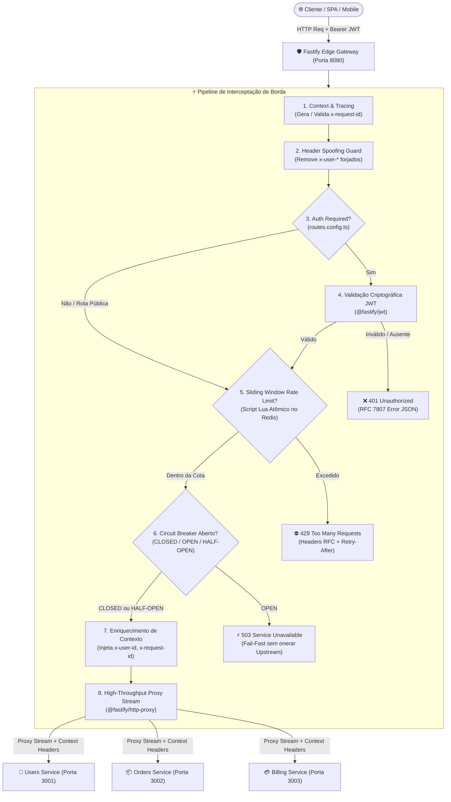
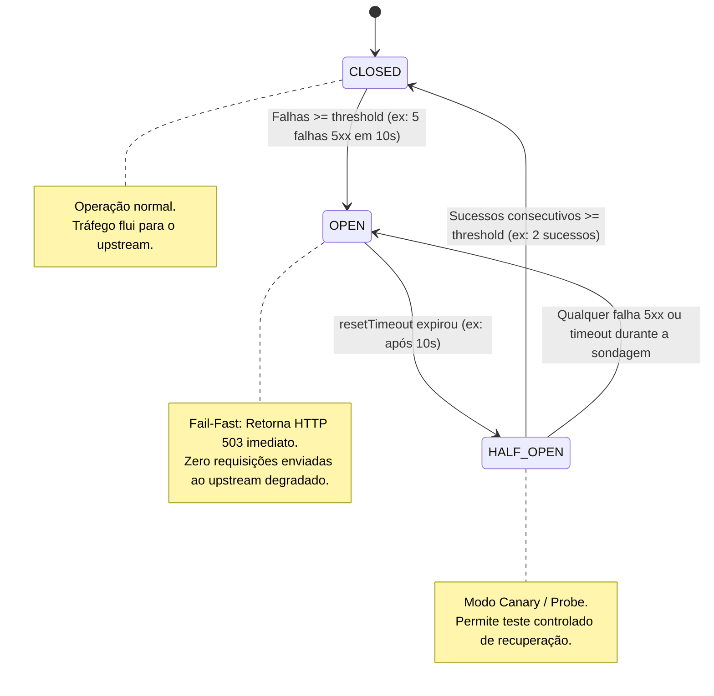

# 🚀 Fastify Edge API Gateway

[](https://github.com/ViktorGabriel/fastify-edge-api-gateway/actions)
[](https://nodejs.org/)
[](https://fastify.dev/)
[](https://redis.io/)
[](https://www.typescriptlang.org/)
[](LICENSE)

API Gateway de borda, ultraleve e de altíssima vazão projetado sob os mais rigorosos padrões de **Engenharia de Infraestrutura e Plataforma**. Desenvolvido com **Fastify 5** e **@fastify/http-proxy**, ele centraliza:
- **Roteamento Declarativo Centralizado:** Mapeado em `src/config/routes.config.ts`.
- **Resiliência com Circuit Breaker:** Estados `CLOSED`, `OPEN` e `HALF-OPEN` com Fail-Fast **HTTP 503** imediato sem onerar serviços degradados.
- **Rate Limiting Atômico:** Baseado em **Sliding Window Counter** com scripts **Lua diretamente no Redis**.
- **Segurança de Borda:** Interceptação e validação criptográfica de tokens **JWT** (`@fastify/jwt`).
- **Enriquecimento de Contexto Distribuído:** Injeção padronizada de **`x-user-id`** e **`x-request-id`**.
- **Imunidade a Header Spoofing:** Expurgo e sanitização de cabeçalhos de identidade forjados externamente.

---

## 🏛️ Arquitetura de Plataforma



---

## ⚡ Padrão Circuit Breaker (Resiliência Downstream)

Para impedir o efeito cascata de indisponibilidade (*cascading failures*), o Gateway implementa uma máquina de estados finita de **Circuit Breaker** por rota/upstream:



### Comportamento em Caso de Falhas do Upstream
1. **Detecção:** O Gateway monitora respostas do upstream com status `5xx` ou timeouts de conexão (`ECONNREFUSED`, `ETIMEDOUT`).
2. **Disparo do Circuito:** Se 5 falhas ocorrerem dentro de uma janela de 10 segundos, o circuito transita imediatamente para **`OPEN`**.
3. **Fail-Fast (503):** Requisições subsequentes são rejeitadas na borda em **< 1ms** com status **`503 Service Unavailable`**, cabeçalho **`Retry-After`** e **`X-Circuit-Breaker-State: OPEN`**, poupando completamente o serviço destino para que ele consiga se recuperar.
4. **Recuperação Gradual (`HALF-OPEN`):** Após o tempo de reset (ex: 10s), o circuito permite requisições controladas de sondagem (*canary requests*). Confirmando 2 sucessos consecutivos, o circuito é automaticamente fechado (**`CLOSED`**) e o tráfego volta à normalidade.

---

## ⏱️ Rate Limiting com Sliding Window Counter (Redis Lua)

A avaliação e o registro das requisições ocorrem em uma **única transação atômica** no Redis via script Lua:
1. `ZREMRANGEBYSCORE key 0 (now - windowMs)`: purga atopicamente eventos fora da janela deslizante móvel.
2. `ZCARD key`: conta o número exato de requisições na janela ativa.
3. Se `count < limit`: adiciona timestamp com `ZADD` e define TTL com `PEXPIRE`. Retorna permitido e saldo restante.
4. Se `count >= limit`: calcula o `retryAfter` exato com base na requisição mais antiga (`ZRANGE`). Retorna HTTP 429 com cabeçalho `Retry-After`.

---

## 📋 Catálogo Declarativo de Rotas (`routes.config.ts`)

Configurado no arquivo central [src/config/routes.config.ts](file:///d:/mais%20projetos/API-Gateway/src/config/routes.config.ts):

| Rota no Gateway | Upstream | Autenticação | Rate Limit | Circuit Breaker | Propósito |
| :--- | :--- | :---: | :---: | :---: | :--- |
| `/api/v1/auth/*` | Users Service | ❌ Não | **5 req / 60s** (IP) | **5 falhas / 10s** | Autenticação pública e emissão de tokens |
| `/api/v1/users/*` | Users Service | ✅ **Sim** | **100 req / 60s** (User) | **5 falhas / 10s** | Gestão de perfis e contas (enriquece `x-user-id`) |
| `/api/v1/catalog/*` | Orders Service | ❌ Não | **200 req / 60s** (IP) | **5 falhas / 10s** | Catálogo aberto com alta vazão por endereço IP |
| `/api/v1/orders/*` | Orders Service | ✅ **Sim** | **20 req / 60s** (User) | **5 falhas / 10s** | Criação e histórico de pedidos |
| `/api/v1/billing/*` | Billing Service | ✅ **Sim** | **10 req / 60s** (User) | **3 falhas / 10s** | Faturamento com controle estrito de concorrência |

---

## 🛠️ Tecnologias Utilizadas

- **Runtime:** [Node.js 22 LTS](https://nodejs.org/)
- **Core Framework:** [Fastify 5](https://fastify.dev/)
- **In-Memory Store:** [Redis 7](https://redis.io/) via [ioredis](https://github.com/redis/ioredis)
- **Proxy Engine:** [@fastify/http-proxy](https://github.com/fastify/fastify-http-proxy)
- **Segurança & Tokens:** [@fastify/jwt](https://github.com/fastify/fastify-jwt), [@fastify/helmet](https://github.com/fastify/fastify-helmet), [@fastify/cors](https://github.com/fastify/fastify-cors)
- **Validação de Schema:** [Zod 3](https://zod.dev/)
- **Linguagem & Tipagem:** [TypeScript 5](https://www.typescriptlang.org/)
- **Testes Automatizados:** [Vitest 3](https://vitest.dev/) & [ioredis-mock](https://github.com/statelyai/ioredis-mock)
- **Bundler:** [tsup](https://tsup.egoist.dev/) (ESM)
- **Containerização:** [Docker](https://www.docker.com/) & [Docker Compose](https://docs.docker.com/compose/)

---

## 🚀 Como Executar

### Pré-requisitos
- Node.js 20+ ou 22+
- Pnpm (ou Npm)
- Docker & Docker Compose

### 1. Clonar e Instalar Dependências

```bash
git clone https://github.com/ViktorGabriel/fastify-edge-api-gateway.git
cd fastify-edge-api-gateway
pnpm install
```

### 2. Configurar Variáveis de Ambiente

```bash
cp .env.example .env
```

### 3. Execução Completa via Docker Compose

Inicia o Redis, o API Gateway e dois microsserviços upstream simulados em uma rede isolada:
```bash
docker compose up --build
```

O Gateway estará pronto e exposto em `http://localhost:8080`.

---

## 🧪 Demonstração Prática com cURL

### 1. Telemetria dos Circuit Breakers
```bash
curl -i http://localhost:8080/gateway/circuit-breakers
```
**Resposta:**
```json
{
  "gateway": "Fastify Edge API Gateway",
  "totalCircuits": 5,
  "circuits": [
    {
      "id": "orders-checkout-protected",
      "state": "CLOSED",
      "failuresCount": 0,
      "failureThreshold": 5,
      "halfOpenSuccessThreshold": 2,
      "totalTrips": 0
    }
  ]
}
```

---

### 2. Resposta do Circuit Breaker em Estado OPEN (Fail-Fast 503)
Quando o serviço upstream falha consecutivamente, o Gateway isola o downstream retornando:
```http
HTTP/1.1 503 Service Unavailable
X-Circuit-Breaker-State: OPEN
Retry-After: 10
x-request-id: c928d34b-4df2-4ce0-9832-15f5a892782b

{
  "statusCode": 503,
  "error": "Service Unavailable",
  "message": "Circuito aberto para o serviço upstream [orders-checkout-protected]. O serviço destino está temporariamente fora de operação.",
  "circuitBreaker": {
    "id": "orders-checkout-protected",
    "state": "OPEN",
    "retryAfter": 10
  },
  "requestId": "c928d34b-4df2-4ce0-9832-15f5a892782b",
  "timestamp": "2026-11-07T23:35:00.000Z"
}
```

---

### 3. Acesso à Rota Protegida com Token JWT e Enriquecimento de Headers
```bash
curl -i http://localhost:8080/api/v1/users/profile \
  -H "Authorization: Bearer <SEU_TOKEN_JWT>"
```
**Resposta do Upstream confirmando recebimento de `x-user-id` e `x-request-id`:**
```json
{
  "message": "Perfil do usuário recuperado com sucesso",
  "service": "users-service",
  "contextReceived": {
    "userId": "usr_viktor_dev",
    "userRole": "platform_lead",
    "requestId": "9a2df718-2c2e-4b6e-b7d6-7cbb1fa02187",
    "forwardedBy": "fastify-api-gateway"
  }
}
```

---

## 🚦 Suíte de Testes Automatizados (Vitest)

A suíte cobre **17 testes de integração e resiliência**:
- **Gateway & Proxy:** Rotas declarativas, validação de JWT, prevenção de Header Spoofing, injeção de correlation ID e HTTP 405.
- **Rate Limiting:** Contagem regressiva de cotas, bloqueio HTTP 429, isolamento por User ID / IP e restauração do Sliding Window no tempo.
- **Circuit Breaker:** Transição de estados (`CLOSED` -> `OPEN` -> `HALF-OPEN` -> `CLOSED`), validação de Fail-Fast 503 (provando que o backend degradado não recebe chamadas) e recuperação automática com sondagem controlada.

```bash
# Executa todos os testes
pnpm test

# Verificação estática de tipos
pnpm run typecheck

# Build de produção (ESM via tsup)
pnpm run build
```

---

## 📄 Licença

Distribuído sob a licença [MIT](LICENSE). Desenvolvido por [Viktor Gabriel](https://github.com/ViktorGabriel).
