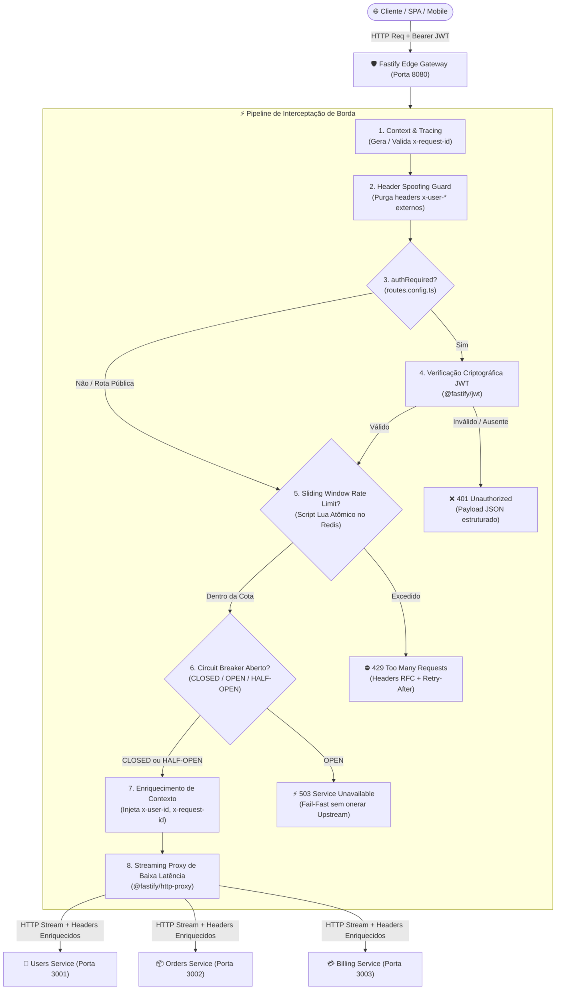
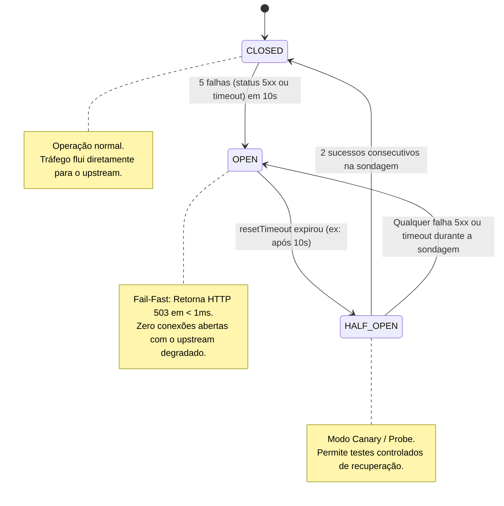

# 🛡️ Fastify Edge API Gateway

[](https://github.com/ViktorGabriel/fastify-edge-api-gateway/actions)
[](https://nodejs.org/)
[](https://fastify.dev/)
[](https://redis.io/)
[](https://www.typescriptlang.org/)
[](vitest.config.ts)
[](LICENSE)

API Gateway de borda L7 de altíssimo throughput e baixíssima latência (sub-milissegundo), projetado sob padrões estritos de **Engenharia de Infraestrutura e Plataforma**. Desenvolvido em **TypeScript** sobre o ecossistema **Fastify 5** e **@fastify/http-proxy**, o gateway atua como ponto único de entrada (*Single Point of Ingress*) para ecossistemas de microsserviços distribuídos, oferecendo segurança perimetral, resiliência ativa e roteamento declarativo desacoplado.

---

## 📌 1. Visão Geral e Propósito do Sistema

Em arquiteturas modernas de microsserviços, delegar autenticação perimetral, contenção de vazão (*rate limiting*) e circuit breaking para cada serviço downstream gera acoplamento operacional, duplicidade de código e desperdício de recursos computacionais. 

O **Fastify Edge API Gateway** centraliza essas responsabilidades na camada de borda:
1. **Zero-Overhead Streaming:** Transfere dados entre clientes e microsserviços via *Node.js Streams* nativos, evitando deserializações custosas de *payload* na memória RAM e reduzindo drasticamente pausas de Garbage Collection (GC).
2. **Defesa em Profundidade:** Validação estrita de tokens JWT, sanitização de cabeçalhos e prevenção ativa contra *Header Spoofing*.
3. **Controle Atômico de Concorrência:** Proteção contra abusos via *Sliding Window Counter* executado de forma atômica no Redis através de scripts Lua.
4. **Isolamento de Falhas (Fault Tolerance):** Interrupção imediata (*Fail-Fast 503*) de chamadas direcionadas a serviços upstream degradados via *Circuit Breaker*.

---

## 🏛️ 2. Diagrama de Arquitetura e Fluxo de Dados

### Fluxo Completo de uma Requisição (End-to-End)



### Máquina de Estados do Circuit Breaker



---

## 🎯 3. Decisões de Design e Engenharia de Produção

### Clean Architecture & Modularização por Plugins
A aplicação adota o encapsulamento estrito do Fastify via `fastify-plugin`, organizando as responsabilidades em plugins ortogonais:
- **`requestContextPlugin`:** Injeta e normaliza o correlation ID (`x-request-id`) no início do ciclo de vida (`onRequest`), viabilizando rastreabilidade distribuída em padrões OpenTelemetry / W3C Trace Context.
- **`authPlugin`:** Decodifica e valida a assinatura HMAC-SHA256 e expiração de tokens JWT, populando `request.user`.
- **`rateLimiterPlugin`:** Intercepta requisições e avalia a cota consumida no Redis antes de permitir a passagem.
- **`circuitBreakerPlugin`:** Isola microsserviços em falha e protege o downstream contra avalanche de requisições.
- **`proxyRouterPlugin`:** Registra proxies dinâmicos via `@fastify/http-proxy` a partir do catálogo central.

### Princípios SOLID Aplicados
- **Single Responsibility Principle (SRP):** Cada plugin e serviço possui uma única responsabilidade de infraestrutura bem definida.
- **Open/Closed Principle (OCP):** A inclusão de novas rotas, upstreams, cotas de rate limit e timeouts é realizada exclusivamente no arquivo declarativo [`routes.config.ts`](file:///d:/mais%20projetos/API-Gateway/src/config/routes.config.ts), sem modificações no core do Gateway.
- **Liskov Substitution & Interface Segregation (LSP/ISP):** Contratos estritos em TypeScript ([`src/types/index.ts`](file:///d:/mais%20projetos/API-Gateway/src/types/index.ts)) desacoplam as implementações dos plugins.
- **Dependency Inversion Principle (DIP):** O `buildApp()` aceita instâncias customizadas de `RedisClient` e catálogo de rotas, viabilizando injeção de mocks e testes de integração determinísticos sem dependências acopladas.

### Tratamento de Concorrência e Atomicidade (Redis Lua)
Contadores simples no Redis que realizam `GET` seguido de `SET` sofrem de condições de corrida (*race conditions*) em clusters distribuídos com alto volume de acessos concorrentes. Para garantir atomicidade matemática:
- O Gateway executa um script **Lua** atômico que manipula uma estrutura de **Sorted Set (`ZSET`)**.
- A pontuação (*score*) corresponde ao timestamp em milissegundos da requisição.
- Eventos anteriores à janela atual são eliminados com `ZREMRANGEBYSCORE key 0 (now - windowMs)`.
- Apenas se a cardinalidade ativa (`ZCARD`) for inferior ao limite, o novo registro é inserido com `ZADD` e o TTL renovado via `PEXPIRE`.

### Prevenção Ativa de Header Spoofing
Clientes maliciosos podem tentar enviar headers internos como `x-user-id: admin` para forjar permissões. O Gateway intercepta e **remove obrigatoriamente** quaisquer cabeçalhos `x-user-*` recebidos do cliente externo. O valor de `x-user-id` injetado na requisição despachada ao upstream deriva **exclusivamente do claim `sub` validado criptograficamente no token JWT**.

---

## 📋 4. Catálogo Declarativo de Rotas (`routes.config.ts`)

| Rota no Gateway | Upstream de Destino | Autenticação | Rate Limit | Circuit Breaker | Propósito |
| :--- | :--- | :---: | :---: | :---: | :--- |
| `/api/v1/auth/*` | Users Service | ❌ Não | **5 req / 60s** (IP) | **5 falhas / 10s** | Autenticação pública e emissão de tokens |
| `/api/v1/users/*` | Users Service | ✅ **Sim** | **100 req / 60s** (User) | **5 falhas / 10s** | Perfil e contas (enriquece `x-user-id`) |
| `/api/v1/catalog/*` | Orders Service | ❌ Não | **200 req / 60s** (IP) | **5 falhas / 10s** | Catálogo aberto de produtos por IP |
| `/api/v1/orders/*` | Orders Service | ✅ **Sim** | **20 req / 60s** (User) | **5 falhas / 10s** | Criação e checkout de pedidos por User ID |
| `/api/v1/billing/*` | Billing Service | ✅ **Sim** | **10 req / 60s** (User) | **3 falhas / 10s** | Processamento de faturamento e faturas |

---

## 🐳 5. Guia de Execução Rápida via Docker Compose

### Pré-requisitos
- Docker Engine 24+ & Docker Compose v2+
- Node.js 20+ ou 22+ (para desenvolvimento local sem containers)
- Pnpm ou Npm

### Variáveis de Ambiente e Portas

| Serviço | Container Name | Porta Exposta | Descrição |
| :--- | :--- | :---: | :--- |
| **API Gateway** | `fastify-api-gateway` | `8080` | Borda L7 de entrada e roteador reverso |
| **Redis** | `gateway-redis` | `6379` | Engine de Rate Limiting (Sliding Window Lua) |
| **Users Service (Mock)** | `upstream-users-service` | `3001` | Microsserviço de autenticação e perfis |
| **Orders Service (Mock)** | `upstream-orders-service` | `3002` | Microsserviço de catálogo e checkout |

### Passo 1: Configurar Variáveis de Ambiente
```bash
cp .env.example .env
```

### Passo 2: Subir a Infraestrutura Completa
```bash
docker compose up --build -d
```

### Passo 3: Verificar Logs e Saúde dos Containers
```bash
docker compose ps
docker compose logs -f api-gateway
```

---

## 📡 6. Exemplos Práticos de Chamadas à API (Payloads JSON)

### 1. Autenticação e Obtenção de Token JWT
**Request:**
```http
POST /api/v1/auth/login HTTP/1.1
Host: localhost:8080
Content-Type: application/json

{
  "userId": "usr_platform_dev_99",
  "role": "staff_engineer",
  "email": "viktor@plataforma.io"
}
```

**Response (200 OK):**
```json
HTTP/1.1 200 OK
Content-Type: application/json; charset=utf-8
x-request-id: 7c5b61f2-1a4e-4f01-9a74-2debc30852d4
X-RateLimit-Limit: 5
X-RateLimit-Remaining: 4
X-RateLimit-Reset: 60

{
  "message": "Login realizado com sucesso no serviço de usuários",
  "token": "eyJhbGciOiJIUzI1NiIsInR5cCI6IkpXVCJ9.eyJzdWIiOiJ1c3JfcGxhdGZvcm1fZGV2Xzk5Iiwicm9sZSI6InN0YWZmX2VuZ2luZWVyIiwiZW1haWwiOiJ2aWt0b3JAcGxhdGFmb3JtYS5pbyIsImlhdCI6MTc5NDExMDgwMCwiZXhwIjoxNzk0MTE0NDAwfQ...",
  "user": {
    "id": "usr_platform_dev_99",
    "role": "staff_engineer",
    "email": "viktor@plataforma.io"
  }
}
```

---

### 2. Chamada à Rota Protegida com Headers Enriquecidos
O cliente envia apenas o token JWT no cabeçalho `Authorization`. O Gateway intercepta, valida e enriquece os cabeçalhos (`x-user-id`, `x-request-id`, `x-forwarded-by`) antes de despachar para o microsserviço:

**Request:**
```http
GET /api/v1/users/profile HTTP/1.1
Host: localhost:8080
Authorization: Bearer <SEU_TOKEN_JWT>
```

**Response do Upstream confirmando recebimento do contexto (200 OK):**
```json
HTTP/1.1 200 OK
Content-Type: application/json; charset=utf-8
x-request-id: b2a8315a-9fa1-4dc2-850c-e274b77f8842
X-Circuit-Breaker-State: CLOSED
X-RateLimit-Limit: 100
X-RateLimit-Remaining: 99
X-RateLimit-Reset: 60

{
  "message": "Perfil do usuário recuperado com sucesso",
  "service": "users-service",
  "contextReceived": {
    "userId": "usr_platform_dev_99",
    "userRole": "staff_engineer",
    "userEmail": "viktor@plataforma.io",
    "requestId": "b2a8315a-9fa1-4dc2-850c-e274b77f8842",
    "forwardedBy": "fastify-api-gateway",
    "gatewayTimestamp": "2026-11-08T00:00:00.000Z"
  }
}
```

---

### 3. Excedendo a Barreira de Rate Limit (HTTP 429 Too Many Requests)
**Request:**
```http
POST /api/v1/auth/login HTTP/1.1
Host: localhost:8080
Content-Type: application/json

{"userId": "bruteforce_attempt"}
```

**Response (429 Too Many Requests com Retry-After conforme RFC 6585):**
```json
HTTP/1.1 429 Too Many Requests
Content-Type: application/json; charset=utf-8
Retry-After: 48
X-RateLimit-Limit: 5
X-RateLimit-Remaining: 0
X-RateLimit-Reset: 48
x-request-id: f092a11b-3128-40a2-9e0c-5192bd887411

{
  "statusCode": 429,
  "error": "Too Many Requests",
  "message": "Limite de requisições excedido. Tente novamente em 48 segundos.",
  "retryAfter": 48,
  "requestId": "f092a11b-3128-40a2-9e0c-5192bd887411",
  "timestamp": "2026-11-08T00:01:00.000Z"
}
```

---

### 4. Circuit Breaker Aberto por Falhas do Upstream (HTTP 503 Fail-Fast)
Quando o microsserviço de pedidos falha consecutivamente (5 falhas 5xx em 10s), o circuito abre e o Gateway rejeita chamadas futuras na borda em < 1ms:

**Response (503 Service Unavailable):**
```json
HTTP/1.1 503 Service Unavailable
Content-Type: application/json; charset=utf-8
X-Circuit-Breaker-State: OPEN
Retry-After: 10
x-request-id: de38491c-8b89-4b6e-a50d-8302194a0293

{
  "statusCode": 503,
  "error": "Service Unavailable",
  "message": "Circuito aberto para o serviço upstream [orders-checkout-protected]. O serviço destino está temporariamente fora de operação.",
  "circuitBreaker": {
    "id": "orders-checkout-protected",
    "state": "OPEN",
    "retryAfter": 10
  },
  "requestId": "de38491c-8b89-4b6e-a50d-8302194a0293",
  "timestamp": "2026-11-08T00:02:00.000Z"
}
```

---

### 5. Telemetria dos Circuit Breakers em Tempo Real
```http
GET /gateway/circuit-breakers HTTP/1.1
Host: localhost:8080
```

**Response (200 OK):**
```json
HTTP/1.1 200 OK
Content-Type: application/json; charset=utf-8

{
  "gateway": "Fastify Edge API Gateway",
  "timestamp": "2026-11-08T00:03:00.000Z",
  "totalCircuits": 5,
  "circuits": [
    {
      "id": "orders-checkout-protected",
      "state": "CLOSED",
      "failuresCount": 0,
      "failureThreshold": 5,
      "consecutiveSuccesses": 12,
      "halfOpenSuccessThreshold": 2,
      "windowMs": 10000,
      "resetTimeoutMs": 10000,
      "retryAfterSeconds": 0,
      "totalTrips": 1
    }
  ]
}
```

---

## 🚦 7. Comandos de Validação Local Pré-Commit

Execute a sequência estrita de comandos para certificar a integridade técnica antes de qualquer commit:

```bash
# 1. Checagem estática de tipos TypeScript (estrito sem emitir código)
npm run typecheck

# 2. Execução única da suíte de testes com cobertura de código (Vitest v8)
npm run test:coverage

# 3. Compilação TypeScript estrita para o diretório dist/
npm run build

# 4. Iniciar o servidor compilado em ambiente de produção
npm start
```

---

## 📄 Licença

Distribuído sob a licença [MIT](LICENSE). Desenvolvido por [Viktor Gabriel](https://github.com/ViktorGabriel).
